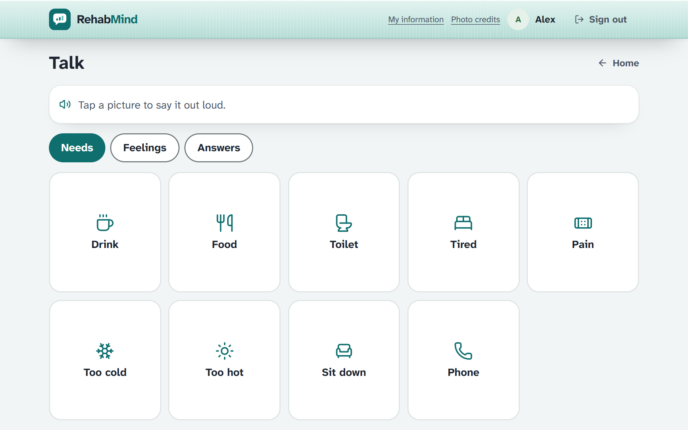
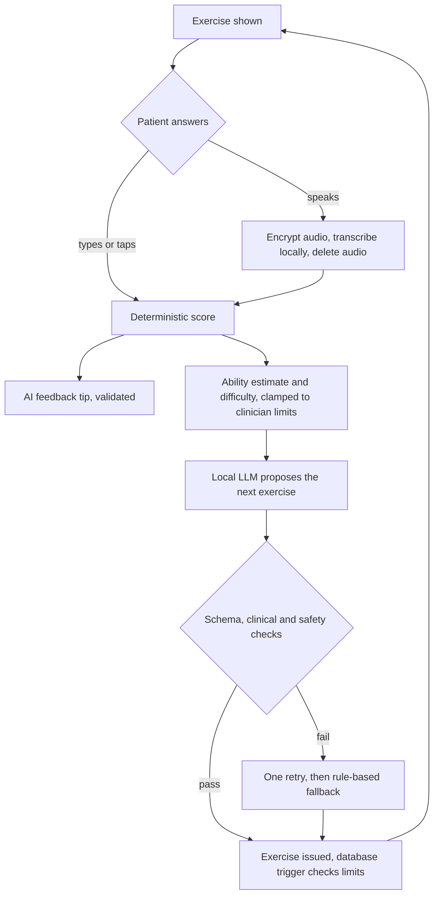
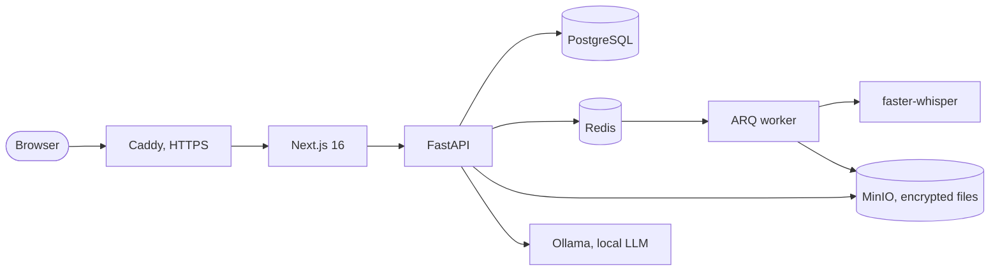

# RehabMind

**Speech and language practice at home for people with aphasia after a stroke, guided by their clinician and supported by local AI.**


Aphasia makes it hard to find, say or put words together. Recovery takes a lot of practice, but time with a speech and language therapist is limited. RehabMind fills the gap between sessions with short, calm picture exercises. Patients answer by speaking, typing or tapping. The app scores each answer and personalises the next exercise, always inside limits set by the patient's clinician.

> **Research prototype.** It isn't a diagnostic tool and hasn't been clinically validated. It runs on seeded test accounts only, and no patient has used it. The clinician is always the authority.

## Screenshots

| Sign in | Patient home |
|---|---|
|  |  |

| A picture exercise with hints | Talk board |
|---|---|
|  |  |

| Clinician overview | AI pipeline view |
|---|---|
|  |  |

Taken with seeded test accounts and simulated practice data. No real patient appears here.

## Who it's for

| Role | What they can do |
|---|---|
| **Patient** | Practise exercises, everyday phrases and their own words. Say things aloud with the talk board. See goals, family notes and a practice calendar, check in their mood, and control who sees their data. |
| **Clinician** | Set goals and practice limits, review sessions and per-word progress, and audit every AI decision. |
| **Family or carer** | See how often the patient practises (never how well), add personal words with photos, and send notes of encouragement. |
| **Admin** | Manage accounts, care teams and family links. Admins see no clinical data. |

## Features

**Seven exercise types**, using real photographs: 52 from the BOSS research set and 18 Wikimedia Commons scenes ([credits](docs/photo-credits.md)).

| Exercise | The patient… | Skill |
|---|---|---|
| Picture naming | names the object in a photo | Word retrieval |
| Sentence completion | finishes a sentence with the pictured word | Word retrieval |
| Word repetition | reads or hears a word and says it back | Repetition |
| Word recognition | picks the photo that matches a word | Word understanding |
| Category naming | picks the photo that belongs to a category | Word meaning |
| Sentence building | orders word tiles to describe a photo | Sentence formation |
| Picture description | describes a scene in their own words | Descriptive language |

**Built around the patient's life**

- **Own words:** family add photos of the patient's people and things. Photos are encrypted, stripped of location data and never sent to the AI.
- **Everyday phrases:** real-life scripts practised line by line: hear it, say it together, say it alone.
- **Talk board:** tap a picture and the device says it aloud.
- **Goals:** written in plain words and measured from practice, never typed in.
- **Mood check-ins and break suggestions:** low mood and fatigue are common after a stroke.
- **My information:** see who can view what, stop sharing with family, and download everything kept.

There are no streaks and no penalty for a missed day. Family see effort, not scores.

## How AI is used

The AI writes content, and the application owns the rehabilitation rules. Scores are deterministic, difficulty stays within the clinician's range, and every generated text is validated and logged.

| Technique | What it does | Where |
|---|---|---|
| **Generative AI** | Personalises exercise wording, writes short feedback tips and drafts clinician summaries | [`backend/app/ai/`](backend/app/ai/) |
| **Deep learning** | Qwen2.5 3B (a transformer, through Ollama) generates text; faster-whisper `small.en` transcribes speech. Both are pretrained and run locally. | [`ai/ollama.py`](backend/app/ai/ollama.py), [`speech/provider.py`](backend/app/speech/provider.py) |
| **Machine learning** | Learns a per-patient ability estimate online from each answer (a Rasch/Elo-style logistic model) | [`performance/ability.py`](backend/app/performance/ability.py) |
| **NLP** | Scores answers with text normalisation and fuzzy matching, and classifies naming errors with Philadelphia Naming Test categories | [`analysis/`](backend/app/analysis/) |
| **Prompt engineering** | Versioned, tested prompts, measured on the real model (below) | [`ai/prompts.py`](backend/app/ai/prompts.py) |

It isn't an agent. Each attempt is one bounded call, with no tools, memory or autonomous decisions. If the AI fails or is switched off, rule-based content takes over and practice carries on.

### Prompt engineering results

The same model, requests and validators were used for every prompt. These are 117 requests per prompt, on pictures kept out of prompt development.

| Prompt | Valid first time | Valid after one retry |
|---|---|---|
| One-line prompt, no schema | 0% | 0% |
| One-line prompt + JSON Schema | 2% | 3% |
| `exercise_generation_v1` | 61% | 75% |
| `exercise_generation_v2` | **83%** | **93%** |

Most of the gain came from naming and sentence building. Picture description did not clearly improve. "Valid" means the output passed the form and safety checks, not that it is true or useful, and only a clinician can judge that. Method, techniques and limits are in [docs/prompt-engineering.md](docs/prompt-engineering.md).

## How it works



**Clinical safety:** the maximum difficulty is enforced in four independent layers: the progression rule, the generator, the exercise issuer and a PostgreSQL trigger. The runtime database role can't alter tables, disable that trigger or edit audit logs.

**Privacy:** speech is transcribed on the app's own server and recordings are deleted afterwards. Prompts contain no names, emails or IDs. See [privacy](docs/privacy.md) and [security](docs/security.md).

### Architecture



| Layer | Technology |
|---|---|
| Frontend | Next.js 16, TypeScript, Tailwind CSS 4, Zod |
| Backend | FastAPI, Pydantic v2, SQLAlchemy 2 (async), Alembic, ARQ |
| Data | PostgreSQL 18, Redis 8, MinIO |
| AI | Ollama with Qwen2.5 3B, faster-whisper |
| Testing | pytest, Hypothesis, Vitest, Playwright, axe-core |
| Ops | Docker Compose, Caddy, GitHub Actions |

## Getting started

You need [Docker](https://www.docker.com/), [uv](https://docs.astral.sh/uv/) and Node.js 24. No paid services or API keys are required.

**1. Set up:**

```bash
cp .env.example .env    # then replace every change-me value
docker compose up -d --wait
cd backend
uv run python -m app.scripts.provision_storage
uv run alembic upgrade head
uv run python -m app.scripts.seed_dev
cd ../frontend
npm install
npm run copy-stimuli
cd ..
```

**2. Run each of these in its own terminal:**

```bash
cd backend && uv run fastapi dev app/main.py
```

```bash
cd backend && uv run python -m app.workers.main
```

```bash
cd frontend && npm run dev
```

**3. Open http://localhost:3000** and sign in as `patient@`, `clinician@`, `carer@` or `admin@recovery.local`. The password is `SEED_DEV_PASSWORD` from your `.env`.

### Turn on the real AI

By default, `AI_PROVIDER=fake` uses an offline stand-in that deliberately produces some bad outputs, so you can see validation and fallback working. To use the real local model, install [Ollama](https://ollama.com), then run:

```bash
ollama pull qwen2.5:3b
```

Then set these in `.env` and restart the API. The second setting is optional and adds the step-by-step AI pipeline view for clinicians:

```bash
AI_PROVIDER=ollama
AI_DEMO_VIEW=true
```

For the self-hosted HTTPS setup, see [deployment](docs/deployment.md).

## Testing

```bash
cd backend && uv run pytest
```

```bash
cd frontend && npm test
```

```bash
cd frontend && npm run test:e2e
```

There are 292 backend tests, 34 frontend unit tests and 30 end-to-end tests, with automated accessibility checks. CI runs them all on every push to `main`, along with a dependency security audit.

## Evidence and limits

**What has been measured**, all without participants ([details](docs/validation/README.md)):

- Typed-answer scoring agrees with labelled answers at κ = 0.95 on a held-out set, with 1.0% false accepts. The answers are synthetic and author-labelled.
- Validators stop unsafe or leaking AI text before it reaches a patient: 14.7% of raw outputs leaked the answer in the audit, and none got through.
- In simulation, ability-guided difficulty keeps 71% of practice in the productive range, against 45% for the step rule.

**What has not been shown:**

- That RehabMind improves recovery or increases practice. Studies with clinicians, older adults and people with aphasia are planned, with [protocols written](docs/validation/protocols/), but none has been run.
- That AI-written cues are correct. Validators check form and safety, so a cue can pass and still be wrong.
- Formal accessibility conformance. WCAG 2.1 AA is the target, self-assessed, and it hasn't been tested with people with aphasia.

## Documentation

| Topic | Documents |
|---|---|
| Product and design | [Product](PRODUCT.md), [Design](DESIGN.md), [Interaction design](docs/interaction-design.md), [Accessibility](docs/accessibility.md) |
| AI | [AI pipeline](docs/ai-pipeline.md), [Prompt engineering](docs/prompt-engineering.md), [GenAI write-up](docs/review2-genai.md) |
| Clinical | [Clinical constraints](docs/clinical-constraints.md), [Clinician workflow](docs/clinician-workflow.md), [Validation](docs/validation/README.md) |
| Engineering | [Architecture](docs/architecture.md), [Development](docs/development.md), [Deployment](docs/deployment.md) |
| Trust | [Security](docs/security.md), [Privacy](docs/privacy.md), [Photo credits](docs/photo-credits.md) |
