#  RehabMind

**AI-assisted, clinician-bounded speech and language practice for people recovering from
stroke-related aphasia.**


-6A1B9A?style=for-the-badge&labelColor=555)


Patients name pictures by **speaking or typing**. RehabMind transcribes speech on its own
server, scores each answer, and personalizes the next exercise, always **inside limits set
by the patient's clinician**. Clinicians see real practice data, manage those limits as
versioned settings, and can audit every AI decision.

> ⚠️ Academic / research prototype. Not a diagnostic tool, not clinically validated, and
> not an autonomous system: the clinician is always the authority.

---

## 📖 About

Aphasia after a stroke makes it hard to find, say or put words together. Recovery depends on
a lot of practice, yet therapy time with a speech and language therapist is limited.
RehabMind fills the gap between sessions with short, calm picture exercises that patients can
do at home, while the clinician stays in charge of every rule that matters.

**Who uses it**

| Role | What they do |
|---|---|
| 🧑‍🦽 **Patient** | Practises seven exercise types (below) by typing, tapping or speaking, plus **everyday phrases** (short real-life scripts, line by line) and their **own words** (photos of their people and things). Uses a **talk board** to say everyday phrases aloud. Sees goals, notes from family and a practice calendar; checks in their mood; controls who sees their data. |
| 👪 **Family / carer** | Sees how often the patient practises (never how well) and their goals, adds the patient's own words with photos, and sends short notes of encouragement. No clinical access. |
| 🩺 **Clinician** | Works in four views: overview, sessions, words (per-picture progress) and plan (goals, own words, practice limits). Sees everyday-phrase practice and mood. The AI audit trail is one step away (AI review). |
| 🛠️ **Admin** | Creates accounts, care-team assignments and family links. Sees no clinical data. |

**Built for the person, not just the exercise**

| Feature | Why |
|---|---|
| Own words (family photos) | Personally relevant words are among the best-supported naming targets; photos are re-encoded without location data, encrypted and visible only to the patient's circle, and never sent to the AI |
| Goals ("Name 10 home words on your own") | Measured from practice, never typed in; shown in plain words |
| Everyday phrases (script training) | Hear it, say it together, say it alone: practice that carries over into real conversations |
| Talk board | Tap a picture and the device speaks: needs, feelings, answers and the patient's own people |
| Family notes and activity | Recovery happens at home; family see effort, not scores |
| Mood check-in, break suggestions | Low mood and fatigue are common after a stroke and change how practice should go |
| My information | Who can see what, stop sharing with family, download everything kept |

**Exercise types** (all with real photographs: 52 from the BOSS research dataset and 18
Wikimedia Commons scenes, see [photo credits](docs/photo-credits.md))

| Exercise | The patient… | Objective |
|---|---|---|
| Picture naming | names the object in a photo | Word retrieval |
| Sentence completion | finishes a sentence with the pictured word | Word retrieval |
| Word repetition | reads or hears a word and says it back | Repetition |
| Word recognition | hears or reads a word and picks the matching photo | Word understanding |
| Category naming | picks the photo that belongs to a category ("an animal") | Word meaning |
| Sentence building | puts word tiles in order to describe a photo | Sentence formation |
| Picture description | describes a scene in their own words | Descriptive language |

**Core idea:** the AI writes the content; the application owns the rehabilitation rules.
Scores are deterministic, difficulty is clamped to the clinician's range, only approved
pictures can be used, and every generated exercise or feedback tip is validated and logged.

**How the AI concepts are used (honestly)**

- **ML**: an online logistic (Rasch/Elo-style) ability estimate per objective, fitted from each patient's answers. No dataset training.
- **DL**: faster-whisper `small.en` for local speech-to-text, used pretrained.
- **Transformer / GenAI**: Qwen2.5-3B through Ollama, used pretrained (not fine-tuned) with three versioned prompts.
- **NLP**: deterministic answer scoring (normalisation, fuzzy match, concepts, word order).

Everything runs locally at **$0**: no paid APIs and no API keys.

---

## 📸 Screenshots

Retake them with the app running: `SEED_DEV_PASSWORD=... node frontend/scripts/readme-screenshots.mjs`.

| Sign in | Patient home |
|---|---|
| 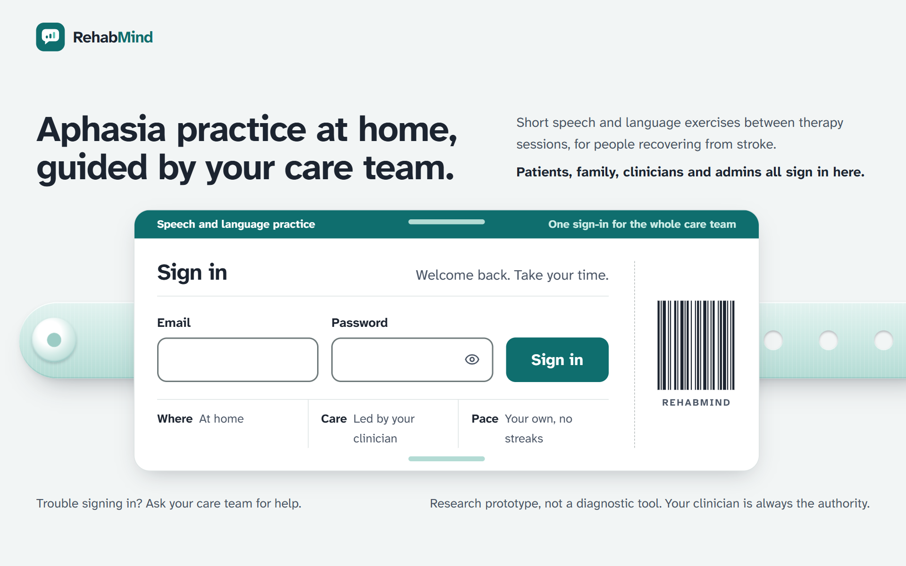 | 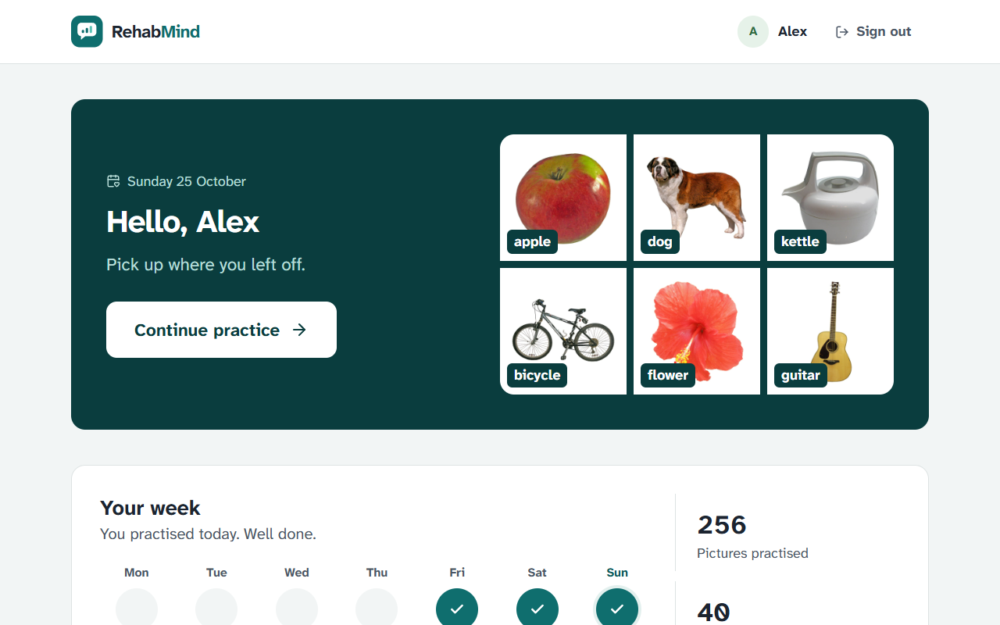 |

| Patient: an exercise with a hint | Patient: feedback with an AI tip |
|---|---|
| 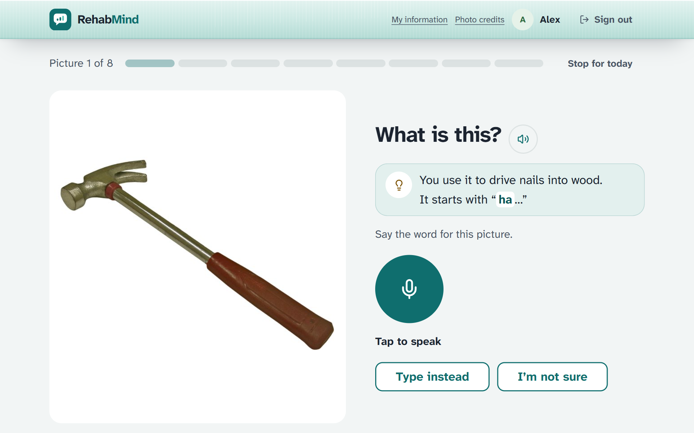 | 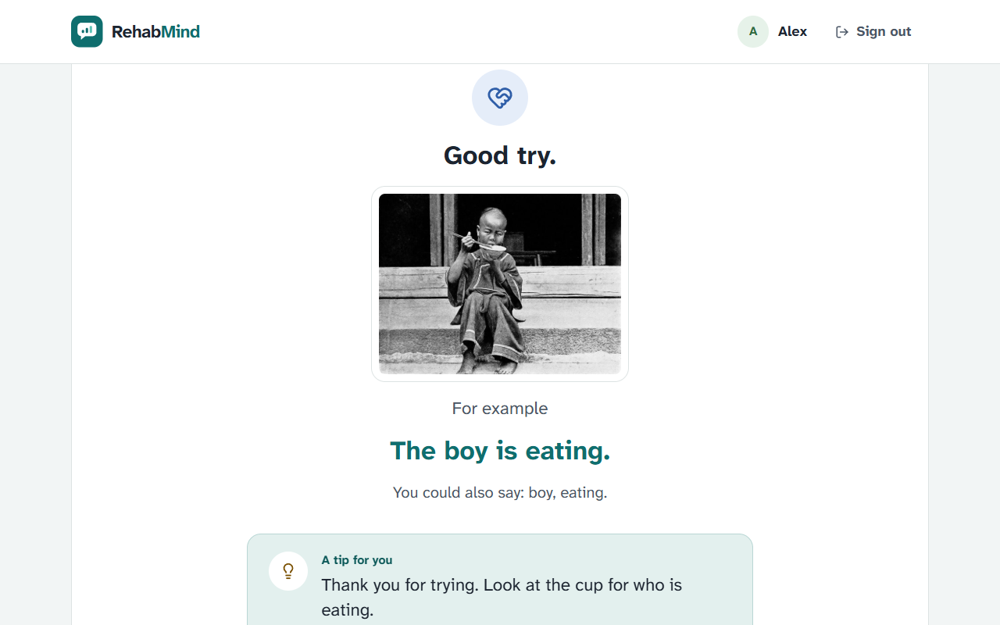 |

| Clinician: dashboard | Clinician: patient overview & trends |
|---|---|
| 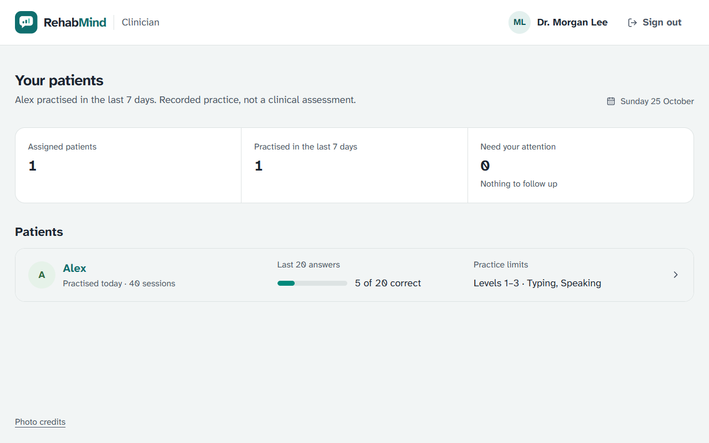 | 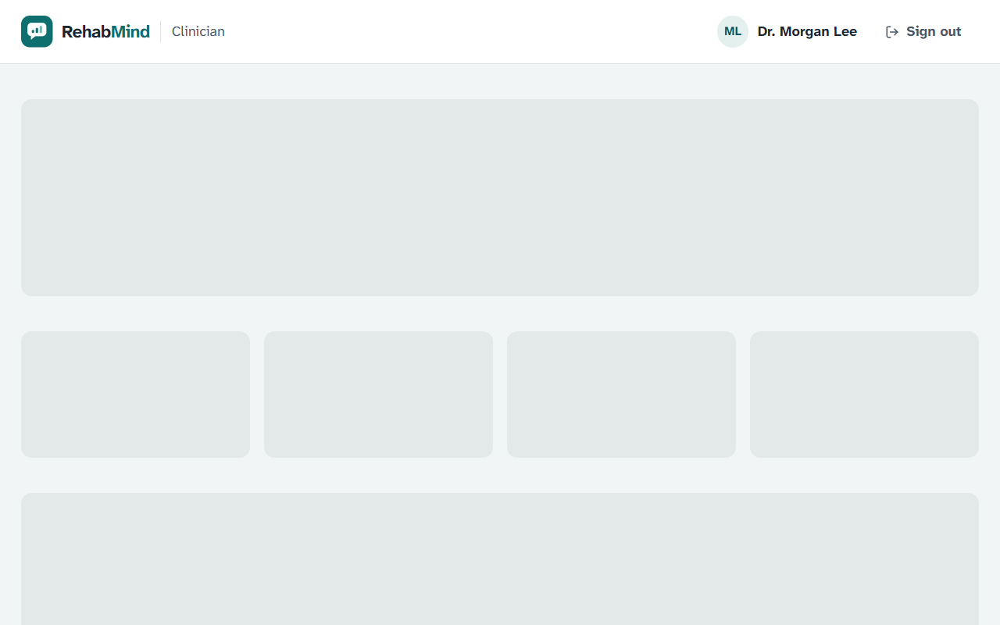 |

| Clinician: versioned practice limits | Clinician: AI pipeline map |
|---|---|
| 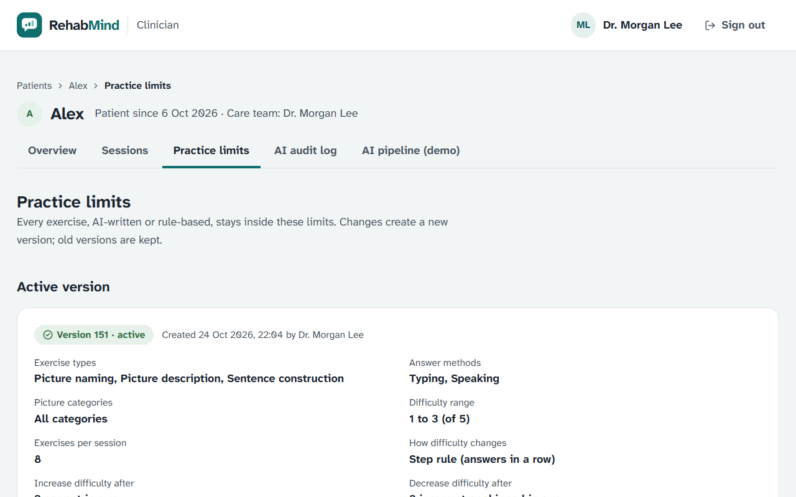 | 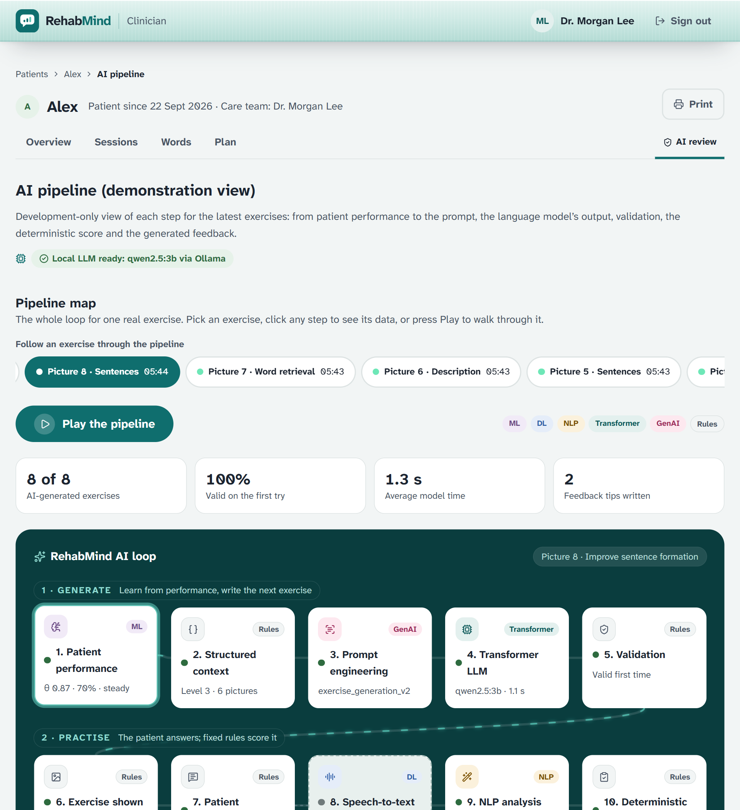 |

<details>
<summary><b>Clinician: AI audit log</b></summary>

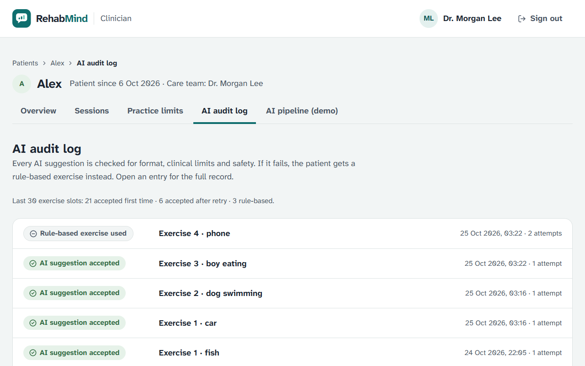
</details>

---

## ✨ Highlights

| 🧑‍🦽 Patients | 🩺 Clinicians | 🛡️ Safety by design |
|---|---|---|
| Real photographs only: 52 normed object photos (BOSS research set) and 18 scenes | Dashboard of assigned patients (real data only) | `MAX_DIFFICULTY` enforced in 4 independent layers, incl. a DB trigger |
| Answer by **voice or typing**; naming, sentence building, picture description | Accuracy & difficulty trends, session history | Generative AI is bounded: schema → clinical → safety validation |
| Hints: meaning first, then first sound | **Versioned practice limits** (never edited, only superseded) | Retry + deterministic fallback; patients are never blocked |
| Warm, honest feedback with the correct word | **AI audit log**: suggestion, verdict, what the patient got | Audio **encrypted → transcribed locally → deleted** |
| Large targets, legible font, reduced motion | Transcript confidence, never raw audio | Whisper hallucinations are never scored |

---

## 🏗️ Architecture

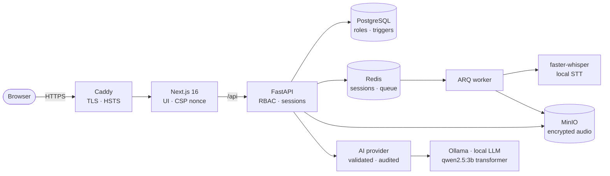

Modular monolith plus a background worker. Only Caddy is exposed. The API, database, cache and
storage are internal.

## 🔁 Core practice loop

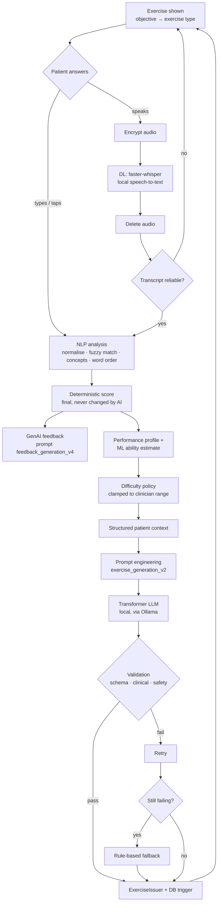

Full GenAI write-up (ML, DL, NLP, transformer, prompts, examples):
[docs/review2-genai.md](docs/review2-genai.md).

## 🛡️ Clinical safety layers

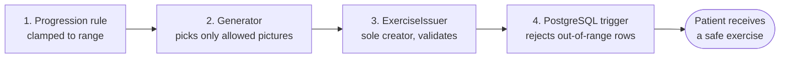

The runtime database role cannot alter tables, disable the trigger, or edit constraint
versions and audit logs.

---

## 🧰 Tech stack

| Layer | Technology |
|---|---|
| Frontend | Next.js 16 (App Router) · TypeScript · Tailwind CSS 4 · Zod · Lucide |
| Backend | FastAPI · Pydantic v2 · SQLAlchemy 2 (async) · Alembic |
| Data | PostgreSQL 18 · Redis 8 · MinIO (S3-compatible) |
| Speech | faster-whisper `small.en` (CPU int8, self-hosted) |
| AI | Local transformer LLM (Qwen2.5 3B via Ollama) behind a provider interface · offline fake provider for tests |
| Ops | Docker Compose · Caddy · GitHub Actions |
| Testing | pytest · Hypothesis · Vitest · Playwright · axe-core |

## 🚀 Quick start

```bash
cp .env.example .env                       # fill in the change-me values
docker compose up -d --wait
cd backend
uv run python -m app.scripts.provision_storage
uv run alembic upgrade head && uv run python -m app.scripts.seed_dev
uv run uvicorn app.main:app --port 8000    # API
uv run python -m app.workers.main          # speech worker (second terminal)
cd ../frontend && npm install && npm run dev   # → http://localhost:3000
```

Real generative AI (local, $0): install [Ollama](https://ollama.com), run
`ollama pull qwen2.5:3b`, and set `AI_PROVIDER=ollama` in `.env` (optionally
`AI_DEMO_VIEW=true` for the clinician's step-by-step AI pipeline view).

Self-hosted HTTPS stack: `docker compose --env-file .env.production -f compose.prod.yaml up -d --build`
(see [deployment](docs/deployment.md)).

## ✅ Quality

- **269** backend tests, including property-based tests of the max-difficulty rule
- **Clinical validation** ([docs/validation](docs/validation/README.md)): scoring benchmark
  (held-out κ = 0.95, 1.0% false accepts), Philadelphia Naming Test error types, a
  difficulty audit against word norms and BOSS name agreement (levels rebalanced), a
  raw-vs-shipped GenAI audit (14.7% of raw outputs leaked the answer; none reached
  patients; feedback valid 89% first time), a learner simulation, and study protocols for
  clinicians, older adults and people with aphasia
- **Dry runs of all three study phases** with simulated participants
  ([docs/validation/simulated.md](docs/validation/simulated.md)): synthetic, not evidence
  about people, but they found that the speech recogniser hears 16% of sound errors as the
  target word, so spoken matches no longer raise difficulty
- **25** Vitest unit tests and **25 Playwright end-to-end** tests, with axe accessibility
  checks on every screen and the Phase 2 usability tasks on phone and laptop
- Phone and tablet layout checks, dependency audits, and a CI workflow

## 📚 Documentation

[Architecture](docs/architecture.md) ·
[Clinical constraints](docs/clinical-constraints.md) ·
[Clinical validation](docs/validation/README.md) ·
[AI pipeline](docs/ai-pipeline.md) ·
[Prompt engineering](docs/prompt-engineering.md) ·
[Clinician workflow](docs/clinician-workflow.md) ·
[Security](docs/security.md) ·
[Privacy](docs/privacy.md) ·
[Accessibility](docs/accessibility.md) ·
[Deployment](docs/deployment.md) ·
[Development](docs/development.md) ·
[Photo credits](docs/photo-credits.md)
